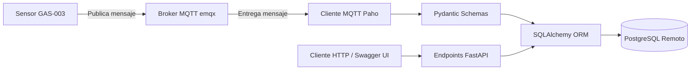

# API para Ingesta, Validación y Consulta de Datos IoT con FastAPI, MQTT y PostgreSQL

## 1. Información General
* **Nombre del Proyecto:** Sistema Backend e Ingesta Telemétrica IoT
* **Asignatura:** Aplicaciones y Servicios Web
* **Integrantes:** Julian Monsalve-Daniel Calle
* **Fecha:** Octubre 2026
* **Sensor Asignado:** `GAS-003` (ID de catálogo: `6`)
* **Tópico MQTT Utilizado:** `iot/sensors/GAS-003/data`

---

## 2. Descripción del Sistema

### Problema Resuelto
El sistema soluciona la ingesta masiva de telemetría proveniente de redes de sensores IoT expuestos a fallas o corrupción de datos. Garantiza que únicamente los payloads que cumplan estrictamente con las reglas de negocio (estructura JSON válida, catálogo de sensores registrado, coincidencia de magnitudes/unidades y valores dentro de los rangos operacionales mínimos y máximos) sean almacenados en PostgreSQL. Además, expone un servicio REST con FastAPI que convierte automáticamente las estampas de tiempo almacenadas en UTC a la hora local de Colombia (`America/Bogota` / UTC-5) para su consumo en interfaces cliente.

### Arquitectura Implementada
La aplicación se estructuró bajo una arquitectura desacoplada y orientada a capas:



1. **Suscriptor MQTT (`app/mqtt/`):** Cliente `paho-mqtt` que se conecta en segundo plano mediante la función de ciclo de vida (`lifespan`) de FastAPI.
2. **Capa de Validación ESTRUCTURAL (`app/schemas/`):** Modelos Pydantic que verifican la presencia de campos obligatorios, tipos primitivos y formato de marcas de tiempo ISO 8601.
3. **Capa de Lógica de Negocio y ORM (`app/crud/` y `app/models/`):** Clases de SQLAlchemy que validan contra PostgreSQL la existencia del sensor, sus magnitudes, las unidades permitidas y los intervalos numéricos `[valor_minimo, valor_maximo]`.
4. **Capa API REST (`app/api/`):** Controladores HTTP expuestos mediante FastAPI para la consulta de datos históricos, filtrado por rangos de fechas, límites y conversión horaria.

### Magnitudes y Unidades Recibidas
El sensor `GAS-003` transmite cuatro variables físicas en sus transmisiones:
* **`no2`:** Dióxido de Nitrógeno, unidad `ppm` (partes por millón).
* **`co`:** Monóxido de Carbono, unidad `ppm`.
* **`temperature`:** Temperatura, unidad `C` (grados Celsius).
* **`humidity`:** Humedad relativa, unidad `%` (porcentaje).

### Payload Real del Sensor
```json
{
  "sensor_id": "GAS-003",
  "timestamp": "2026-10-10T00:56:45+00:00",
  "measurements": {
    "no2": {"value": 0.67, "unit": "ppm"},
    "co": {"value": 5.87, "unit": "ppm"},
    "temperature": {"value": 19.36, "unit": "C"},
    "humidity": {"value": 71.39, "unit": "%"}
  }
}
```

---

## 3. Configuración del Entorno

1. **Creación del entorno virtual:**
   ```bash
   python -m venv .venv
   ```

2. **Activación del entorno virtual:**
   * En Windows (PowerShell): `.venv\Scripts\Activate.ps1`
   * En Linux / macOS: `source .venv/bin/activate`

3. **Instalación de dependencias instaladas en `requirements.txt`:**
   ```bash
   pip install -r requirements.txt
   ```

4. **Variables de Entorno (`.env`):**
   Las credenciales sensibles del servidor PostgreSQL y la ruta del broker MQTT se almacenan en un archivo `.env` en la raíz del proyecto (el cual está excluido del control de versiones mediante `.gitignore`):
   ```text
   DB_HOST=servidor_remoto_postgres.com
   DB_PORT=5432
   DB_NAME=nombre_base_datos
   DB_USER=usuario_postgres
   DB_PASSWORD=contrasena_segura
   MQTT_BROKER=emqx.coriotlab.co
   MQTT_PORT=1883
   ```

---

## 4. Base de Datos
Se utilizó PostgreSQL en la nube administrado mediante SQLAlchemy ORM.

### Tablas Utilizadas y Relaciones
1. **`sensores`:** Almacena el catálogo de equipos registrados.
   * Clave Primaria: `id` (entero).
   * Identificador de red: `codigo` (string, ej. `"GAS-003"`).
2. **`sensor_magnitudes`:** Relaciona los sensores con sus variables operacionales.
   * Clave Primaria: `id` (entero).
   * Clave Foránea: `sensor_id` $\rightarrow$ `sensores.id`.
   * Campos: `magnitud`, `unidad`, `valor_minimo`, `valor_maximo`.
3. **`mediciones`:** Guarda el histórico de lecturas.
   * Clave Primaria: `id` (entero).
   * Clave Foránea: `sensor_magnitud_id` $\rightarrow$ `sensor_magnitudes.id`.
   * Campos: `valor`, `timestamp_utc`, `fecha_recepcion`.
* **Relaciones implementadas:** 
  La arquitectura de datos respeta la integridad referencial para evitar la eliminación de históricos y prevenir la inserción de métricas huérfanas:
  * `sensores` **1:N** `sensor_magnitudes` (FK: `sensor_id` → `sensores.id`).
  * `sensor_magnitudes` **1:N** `mediciones` (FK: `sensor_magnitud_id` → `sensor_magnitudes.id`).
  Ambas relaciones implementan internamente reglas equivalentes a `ON DELETE RESTRICT` para blindar la persistencia de los registros en PostgreSQL.   

---

## 5. Organización del Código
El proyecto implementa una estricta separación de responsabilidades:

* **`app/schemas/`:** Define las estructuras Pydantic utilizadas para validar los payloads JSON entrantes desde MQTT y formatear la salida serializada de la API HTTP.
* **`app/models/`:** Contiene la declaración de clases SQLAlchemy que mapean de manera bidireccional las tablas de PostgreSQL.
* **`app/crud/`:** Agrupa la lógica de acceso a datos, validación cruzada de reglas de negocio y transacciones de inserción.
* **`app/api/`:** Contiene las rutas REST de FastAPI divididas en módulos (`sensor.py`, `sensor_magnitud.py`, `medicion.py`).
* **`app/mqtt/`:** Administra el cliente Paho MQTT, la suscripción al tópico asignado y el manejo de eventos `on_connect` y `on_message`.
* **`app/database/`:** Administra la creación de la sesión de base de datos (`SessionLocal`) y la inyección de dependencias (`get_db`).

---

## 6. Endpoints Implementados

| Método | Ruta | Descripción |
| :---: | :--- | :--- |
| `GET` | `/sensores` | Obtiene la lista completa de sensores registrados en el catálogo. |
| `GET` | `/sensores/{id}` | Obtiene la información de un sensor mediante su clave primaria numérica. |
| `GET` | `/sensores/por-codigo/{codigo}` | Consulta la entidad del sensor buscando por su código de red (ej. `GAS-003`). |
| `GET` | `/sensores/{id}/magnitudes` | Lista la configuración de magnitudes y límites asociados a un sensor. |
| `GET` | `/sensor-magnitudes/{id}` | Obtiene el detalle de una relación magnitud-sensor individual. |
| `GET` | `/mediciones/{id}` | Obtiene una medición individual transformando su timestamp a hora Colombia. |
| `GET` | `/sensores/{id}/mediciones` | Consulta el histórico de mediciones con filtros opcionales (`magnitud`, `desde`, `hasta`, `limit`). |
| `GET` | `/sensores/{id}/ultima-medicion` | Retorna exclusivamente el registro telemétrico más reciente capturado por el sensor. |

---

## 7. Evidencias de Funcionamiento
Las comprobaciones ejecutadas durante la fase de validación se encuentran documentadas de manera individual dentro de la carpeta **`evidencias/`** en el repositorio:

* **Pruebas 1 a 7 (Manejo MQTT):** Confirmación de la ingesta durante 20+ minutos, almacenamiento en PostgreSQL de mensajes correctos y descarte controlado por logs de mensajes con sensores inexistentes, unidades inválidas, magnitudes alteradas o marcas de tiempo corruptas.
* **Pruebas 8 a 16 (API FastAPI):** Verificación de respuestas con códigos de estado HTTP **200 OK**, **400 Bad Request** (rango `desde > hasta`), **404 Not Found** (recursos inexistentes) y **422 Unprocessable Entity** (validación de tipos).
* **Pruebas 17 y 18:** Confirmación de integridad referencial mediante claves foráneas y comprobación de la arquitectura modular.

---

## 8. Control de Versiones

* https://github.com/julianm17297/Aplicaciones-y-servicios-web/tree/taller-2
* **Estrategia de Ramificación:** El desarrollo se llevó a cabo sobre la rama de trabajo `taller-2` integrada mediante commits frecuentes hacia la rama principal `main`.
* **Participación y Aportes del Equipo:**
  * **Integrante 1:** Configuración de la conexión a PostgreSQL, definición de modelos ORM SQLAlchemy, creación de Schemas Pydantic e implementación de la integración con el cliente MQTT.
  * **Integrante 2:** Desarrollo de controladores y rutas en FastAPI, lógica de conversión a zona horaria local (`America/Bogota`), construcción de filtros combinados de consulta y redacción del informe final con su set de evidencias.

---

## 9. Conclusiones
1. El rechazo entre la validación de sintaxis (Pydantic) y la validación de reglas de negocio (ORM y PostgreSQL) previene la contaminación de la base de datos sin comprometer el rendimiento ni la estabilidad del servidor backend.
2. Almacenar los registros de tiempo de forma unificada en la referencia internacional UTC permite mantener la consistencia en bases de datos distribuidas, postergando la transformación a la zona horaria local (`America/Bogota` / UTC-5) únicamente para el consumo visual de los usuarios mediante la API REST.
3. La utilización del framework FastAPI junto con Uvicorn simplifica la verificación de contratos de integración gracias a la generación nativa e interactiva de la especificación OpenAPI (Swagger UI).

## 10. Bibliografía

FastAPI. FastAPI Documentation. https://fastapi.tiangolo.com
Pydantic. Pydantic Documentation. https://docs.pydantic.dev
SQLAlchemy. SQLAlchemy Documentation. https://docs.sqlalchemy.org
PostgreSQL Global Development Group. PostgreSQL Documentation. https://www.postgresql.org/docs/
OASIS. MQTT Version 5.0. https://docs.oasis-open.org/mqtt/mqtt/v5.0/mqtt-v5.0.html
Python Software Foundation. Python Documentation. https://docs.python.org
Chacon, S., & Straub, B. (2014). Pro Git. Apress.