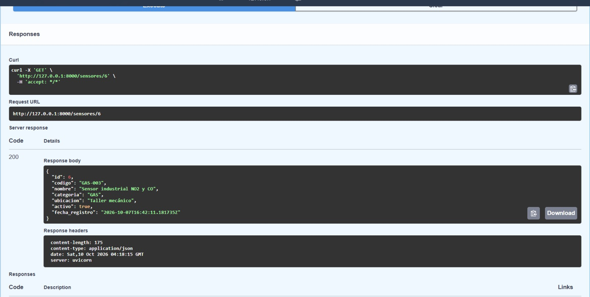
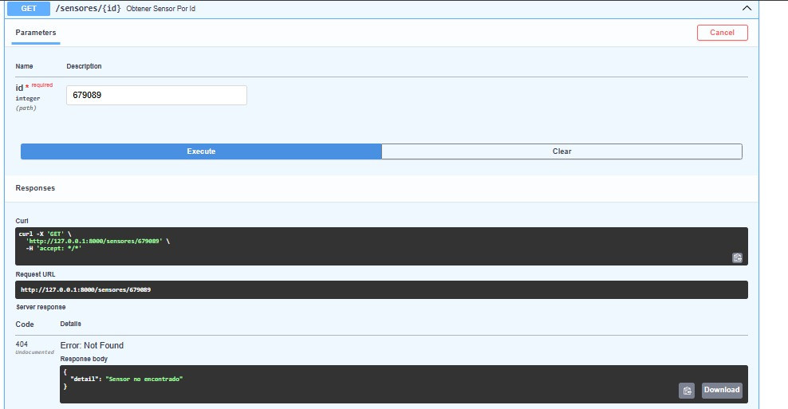
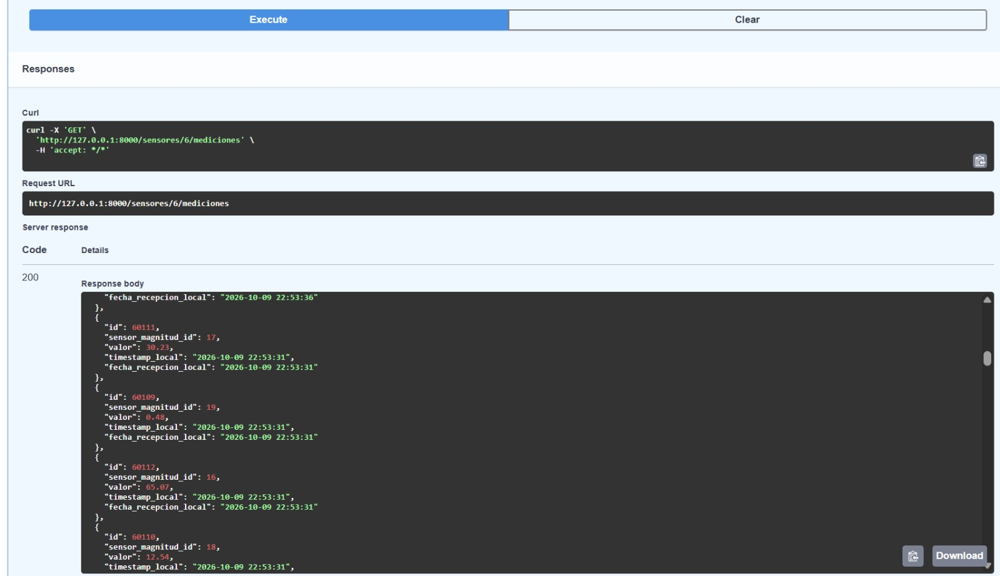
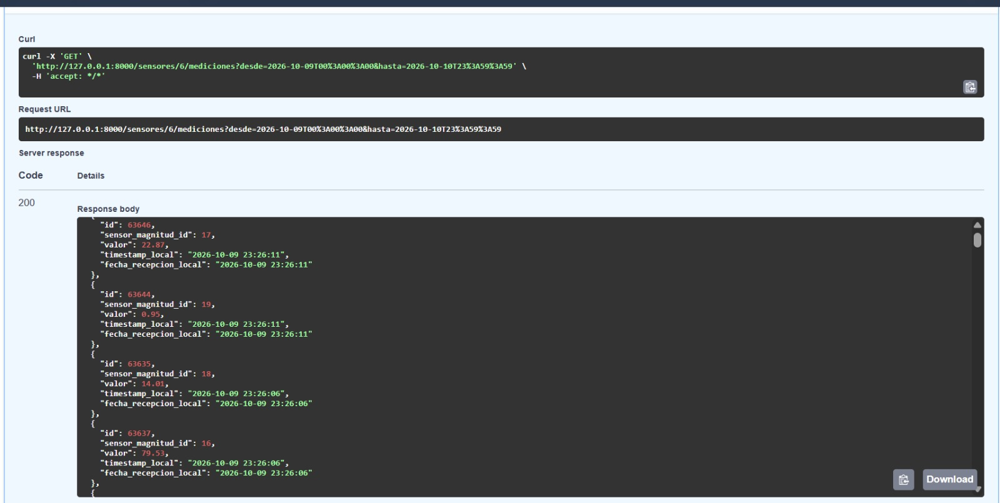
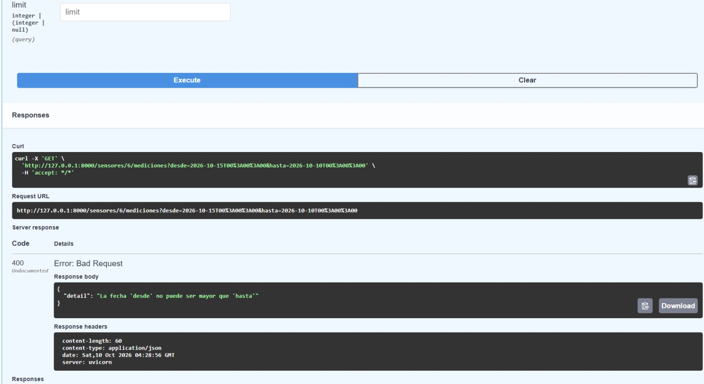
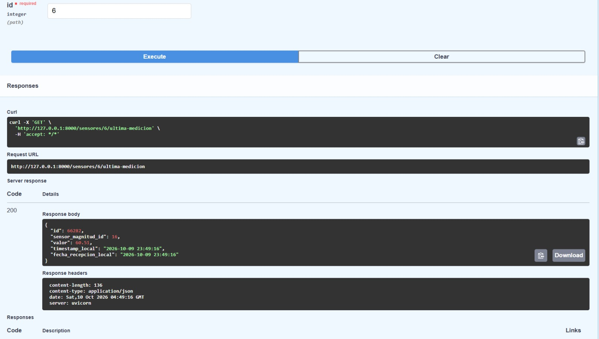
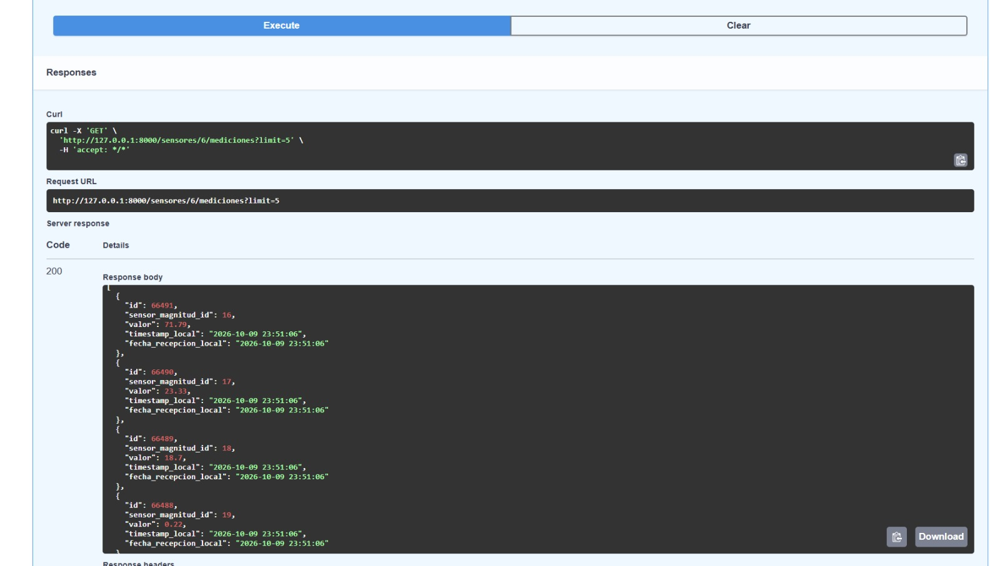
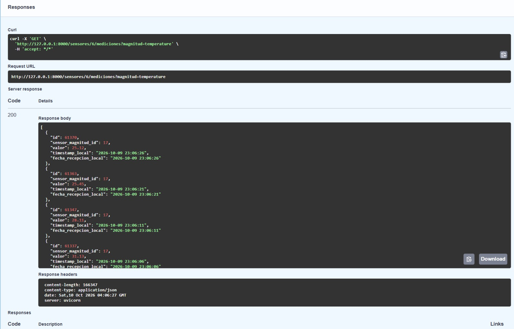
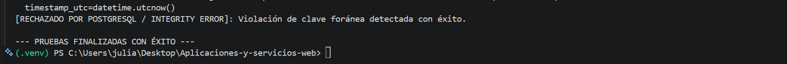

# Evidencias de Ingesta MQTT y Validaciones de Negocio (Pruebas 1 a 7)

Este documento contiene la sustanciación técnica de las pruebas de recepción, validación y control de calidad de datos consumidos a través del protocolo MQTT para el sensor asignado `GAS-003`.

---

### Evidencia 1: Recepción MQTT
* **Prueba número:** 1
* **Datos de entrada:** Payload JSON en tiempo real publicado por el broker `emqx.coriotlab.co` en el tópico `iot/sensors/GAS-003/data`:
  ```json
  {
    "sensor_id": "GAS-003",
    "timestamp": "2026-10-10T00:56:45+00:00",
    "measurements": {
      "no2": {"value": 0.67, "unit": "ppm"},
      "co": {"value": 5.87, "unit": "ppm"},
      "temperature": {"value": 19.36, "unit": "C"},
      "humidity": {"value": 71.39, "unit": "%"}
    }
  }
  ```
* **Resultado obtenido:** Intercepción, decodificación de bytes a UTF-8 e interpretación del buffer JSON en la consola de ejecución.
* **Registro de consola:** `[ÉXITO] Medición almacenada. Sensor: GAS-003 | UTC: 2026-10-10 05:31:32+00:00`
* **Archivo y función relacionados:**
  * **Archivo:** `app/mqtt/client.py`
  * **Función:** `on_message(client, userdata, msg)`
* **Explicación:** El cliente Paho MQTT procesa el callback cuando llega un paquete al tópico asignado y transfiere el diccionario parsed al controlador CRUD para su procesamiento.

---

### Evidencia 2: Medición Válida (Almacenamiento en PostgreSQL)
* **Prueba número:** 2
* **Datos de entrada:** Objeto `PayloadMQTT` con el código de sensor `GAS-003`, marca de tiempo ISO 8601 en UTC y mediciones cuyas magnitudes (`no2`, `co`, `temperature`, `humidity`) coinciden en unidad y rango con el catálogo.
* **Resultado obtenido:** Persistencia individual de cada magnitud en la tabla `mediciones` compartiendo la clave foránea `sensor_magnitud_id` y el mismo `timestamp_utc`.
* **Registro de consola:** `[ÉXITO] Medición almacenada. Sensor: GAS-003 | UTC: 2026-10-10 05:31:37+00:00`
* **Archivo y función relacionados:**
  * **Archivo:** `app/crud/medicion.py`
  * **Función:** `procesar_y_guardar_payload(db: Session, payload: PayloadMQTT)`
* **Explicación:** El sistema verifica la existencia del sensor ID `6`, comprueba las reglas de negocio para cada magnitud y efectúa `db.commit()` en PostgreSQL.

---

### Evidencia 3: Sensor Inexistente
* **Prueba número:** 3
* **Datos de entrada:** Payload con identificador `"sensor_id": "SENSOR-INEXISTENTE-999"`.
* **Resultado obtenido:** Transacción abortada; el sistema rechazó el mensaje sin alterar las tablas de la base de datos.
* **Registro de consola:** `[RECHAZADO CONTROLADO POR NEGOCIO]: Sensor SENSOR-INEXISTENTE-999 no existe en el catálogo.`
* **Archivo y función relacionados:**
  * **Archivo:** `app/crud/sensor.py` y `app/crud/medicion.py`
  * **Función:** `get_sensor_by_codigo()` y `procesar_y_guardar_payload()`
* **Explicación:** Al realizar la consulta ORM por la clave `codigo`, la base de datos devolvió `None`, disparando la excepción controlada que detiene la inserción.

---

### Evidencia 4: Unidad Incorrecta
* **Prueba número:** 4
* **Datos de entrada:** Payload enviando `"temperature": {"value": 25.0, "unit": "Fahrenheit"}`.
* **Resultado obtenido:** Rechazo del mensaje por incompatibilidad de unidad frente al catálogo registrado.
* **Registro de consola:** `[RECHAZADO CONTROLADO POR NEGOCIO]: Unidad incorrecta para temperature. Esperada: C, Recibida: Fahrenheit.`
* **Archivo y función relacionados:**
  * **Archivo:** `app/crud/medicion.py`
  * **Función:** `procesar_y_guardar_payload()`
* **Explicación:** Se comparó la cadena de texto de la unidad recibida contra `SensorMagnitud.unidad`. Al no coincidir con la norma (`C`), se canceló la transacción.

---

### Evidencia 5: Tipo de Dato Incorrecto
* **Prueba número:** 5
* **Datos de entrada:** Payload enviando un texto no numérico en el valor: `"temperature": {"value": "veinticinco", "unit": "C"}`.
* **Resultado obtenido:** Intercepción inmediata en la capa de esquemas sin realizar operaciones de I/O en la base de datos.
* **Registro de consola:** `[RECHAZADO CONTROLADO POR PYDANTIC]: Input should be a valid number, unable to parse string as a number`
* **Archivo y función relacionados:**
  * **Archivo:** `app/schemas/medicion.py`
  * **Función:** Modelo Pydantic `MeasurementValue` / `PayloadMQTT`
* **Explicación:** Pydantic valida los tipos de datos en la deserialización. Al requerir `float` e ingresar una cadena no convertible, eleva un `ValidationError`.

---

### Evidencia 6: Magnitud Incorrecta
* **Prueba número:** 6
* **Datos de entrada:** Payload incluyendo una variable no medida por el sensor: `"presion_atmosferica": {"value": 1013.25, "unit": "hPa"}`.
* **Resultado obtenido:** Rechazo del paquete por falta de relación en la base de datos.
* **Registro de consola:** `[RECHAZADO CONTROLADO POR NEGOCIO]: El sensor GAS-003 no tiene configurada la magnitud 'presion_atmosferica'.`
* **Archivo y función relacionados:**
  * **Archivo:** `app/crud/medicion.py`
  * **Función:** `procesar_y_guardar_payload()`
* **Explicación:** La consulta ORM verificó las magnitudes asociadas al sensor `GAS-003` (ID `6`). Al no existir la clave foránea correspondiente, se canceló el guardado.

---

### Evidencia 7: Timestamp Inválido
* **Prueba número:** 7
* **Datos de entrada:** Payload enviando una marca de tiempo corrupta: `"timestamp": "fecha-invalida"`.
* **Resultado obtenido:** Intercepción y descarte del mensaje en la capa de parseo.
* **Registro de consola:** `[RECHAZADO CONTROLADO POR PYDANTIC]: Input should be a valid datetime or date, invalid character in year`
* **Archivo y función relacionados:**
  * **Archivo:** `app/schemas/medicion.py`
  * **Función:** Campo `timestamp: datetime` en `PayloadMQTT`
* **Explicación:** Pydantic valida que las estampas temporales cumplan estrictamente con la notación ISO 8601. Al recibir una cadena inválida, rechaza la construcción del objeto.

# Evidencias de API REST, Endpoints y Arquitectura (Pruebas 8 a 18)

Este documento contiene la sustanciación técnica de las pruebas realizadas sobre los endpoints HTTP expuestos con FastAPI, el manejo de códigos de estado, filtros de consulta y la verificación de la arquitectura del proyecto.

---

### Evidencia 8: Consulta por ID existente
* **Prueba número:** 8
* **Datos de entrada:** Solicitud `GET` a la ruta `/sensores/6` usando Swagger UI.
* **Resultado obtenido:** Se retornó el objeto JSON con la información correcta del sensor `GAS-003` (categoría "GAS", ubicación "Taller mecánico", activo: true).
* **Código HTTP:** `200 OK`
* **Registro almacenado o rechazado:** Consulta exitosa (Lectura).
* **Archivo y función relacionados:** `app/api/sensor.py` -> `obtener_sensor_por_id()`
* **Explicación:** El endpoint recibe el ID numérico por parámetro de ruta, realiza la consulta mediante el ORM a la tabla `sensores` y serializa la respuesta utilizando el esquema Pydantic correspondiente.



---

### Evidencia 9: Consulta por ID inexistente
* **Prueba número:** 9
* **Datos de entrada:** Solicitud `GET` a la ruta `/sensores/679089`.
* **Resultado obtenido:** El sistema no encontró el ID en la base de datos y retornó un JSON con el detalle `{"detail": "Sensor no encontrado"}`.
* **Código HTTP:** `404 Not Found`
* **Registro almacenado o rechazado:** Petición rechazada (Recurso no encontrado).
* **Archivo y función relacionados:** `app/api/sensor.py` -> `obtener_sensor_por_id()` / `app/crud/sensor.py` -> `get_sensor()`
* **Explicación:** Al hacer la consulta `db.query(Sensor).filter(Sensor.id == 679089).first()`, SQLAlchemy retorna `None`. El controlador detecta esto y lanza explícitamente un `HTTPException(status_code=404)`.



---

### Evidencia 10: Consulta histórica
* **Prueba número:** 10
* **Datos de entrada:** Solicitud `GET` a la ruta `/sensores/6/mediciones` sin parámetros de filtro adicionales.
* **Resultado obtenido:** Retorno de un arreglo JSON con el historial de mediciones (ej. ids `60111`, `60109`, `60112`). Se evidencia la conversión del timestamp UTC a la hora local (`timestamp_local`: "2026-10-09 22:53:31").
* **Código HTTP:** `200 OK`
* **Registro almacenado o rechazado:** Consulta exitosa (Lectura masiva).
* **Archivo y función relacionados:** `app/api/medicion.py` -> `obtener_mediciones_sensor()`
* **Explicación:** El endpoint recupera el historial de la tabla `mediciones` unidas por el sensor, aplicando una transformación de zona horaria (`America/Bogota`) antes de retornar el modelo Pydantic.



---

### Evidencia 11: Consulta por rango de fechas
* **Prueba número:** 11
* **Datos de entrada:** Solicitud `GET` a la ruta `/sensores/6/mediciones?desde=2026-10-09T00:00:00&hasta=2026-10-10T23:59:59`.
* **Resultado obtenido:** Arreglo JSON acotado estrictamente a los registros que caen dentro del intervalo de fechas indicado (ej. fechas devueltas: "2026-10-09 23:26:11").
* **Código HTTP:** `200 OK`
* **Registro almacenado o rechazado:** Consulta exitosa (Lectura filtrada).
* **Archivo y función relacionados:** `app/api/medicion.py` / `app/crud/medicion.py` -> `get_mediciones_by_sensor()`
* **Explicación:** Los parámetros query `desde` y `hasta` son inyectados en la consulta ORM utilizando operadores `>=` y `<=`, acotando el `SELECT` a nivel de base de datos antes de serializar.



---

### Evidencia 12: Rango desde > hasta
* **Prueba número:** 12
* **Datos de entrada:** Solicitud `GET` enviando un límite inicial mayor al final: `?desde=2026-10-15...&hasta=2026-10-10...`.
* **Resultado obtenido:** Intercepción de la consulta y retorno del error `{"detail": "La fecha 'desde' no puede ser mayor que 'hasta'"}`.
* **Código HTTP:** `400 Bad Request`
* **Registro almacenado o rechazado:** Petición rechazada (Falla de validación de negocio).
* **Archivo y función relacionados:** `app/api/medicion.py` -> `obtener_mediciones_sensor()`
* **Explicación:** Antes de tocar la base de datos, el controlador compara las fechas recibidas. Al detectar la inconsistencia temporal, eleva un `HTTPException(status_code=400)` para proteger la carga del servidor.



---

### Evidencia 13: Validación HTTP incorrecta
* **Prueba número:** 13
* **Datos de entrada:** Solicitud `GET` enviando un string en lugar de un entero en el parámetro de ruta: `/sensores/texto_invalido` (Probado en Swagger y vía `Invoke-WebRequest` en PowerShell).
* **Resultado obtenido:** Bloqueo automático de la ruta informando que el valor `id` debe ser un número entero (`"type": "int_parsing"`).
* **Código HTTP:** `422 Unprocessable Entity`
* **Registro almacenado o rechazado:** Petición rechazada (Falla de validación estructural).
* **Archivo y función relacionados:** `app/api/sensor.py` (Definición de ruta) y validación interna de FastAPI/Pydantic.
* **Explicación:** FastAPI infiere los tipos de datos basándose en el tipado estático de Python (`sensor_id: int`). Al recibir "texto_invalido", Pydantic detiene el flujo y retorna automáticamente el error 422.


---

### Evidencia 14: Última medición
* **Prueba número:** 14
* **Datos de entrada:** Solicitud `GET` a la ruta `/sensores/6/ultima-medicion`.
* **Resultado obtenido:** Un único objeto JSON con el registro más reciente (id `66282`, valor `60.51`, fecha "2026-10-09 23:49:16").
* **Código HTTP:** `200 OK`
* **Registro almacenado o rechazado:** Consulta exitosa (Lectura simple).
* **Archivo y función relacionados:** `app/api/medicion.py` -> `obtener_ultima_medicion()`
* **Explicación:** El ORM ejecuta una consulta ordenando por el `timestamp_utc` en orden descendente (`.order_by(Medicion.timestamp_utc.desc())`) y utilizando `.first()` para traer solo el registro más nuevo.



---

### Evidencia 15: Últimas N mediciones
* **Prueba número:** 15
* **Datos de entrada:** Solicitud `GET` a la ruta `/sensores/6/mediciones?limit=5`.
* **Resultado obtenido:** Un arreglo JSON que contiene exactamente 5 registros (ids 66491 al 66488).
* **Código HTTP:** `200 OK`
* **Registro almacenado o rechazado:** Consulta exitosa (Lectura limitada).
* **Archivo y función relacionados:** `app/crud/medicion.py` -> `get_mediciones_by_sensor()`
* **Explicación:** El parámetro `limit` es inyectado al final de la consulta SQLAlchemy (`.limit(limit)`), optimizando el ancho de banda y devolviendo solo la cantidad de datos requerida por el cliente.



---

### Evidencia 16: Filtro por magnitud
* **Prueba número:** 16
* **Datos de entrada:** Solicitud `GET` a la ruta `/sensores/6/mediciones?magnitud=temperature`.
* **Resultado obtenido:** El arreglo JSON filtró los resultados, devolviendo únicamente los registros asociados al `sensor_magnitud_id: 17` (que corresponde a Temperatura), omitiendo humedad y gases.
* **Código HTTP:** `200 OK`
* **Registro almacenado o rechazado:** Consulta exitosa (Lectura filtrada).
* **Archivo y función relacionados:** `app/crud/medicion.py` -> `get_mediciones_by_sensor()`
* **Explicación:** Se realiza un JOIN con la tabla `sensor_magnitudes` y se aplica un `.filter(SensorMagnitud.magnitud == magnitud)` para retornar solo las métricas de interés.



---

### Evidencia 17: Claves Foráneas (Integridad Referencial)
* **Prueba número:** 17
* **Datos de entrada:** Intento de inserción en la base de datos de una medición con un ID de magnitud huérfano o inexistente.
* **Resultado obtenido:** Operación abortada por la base de datos PostgreSQL arrojando un error de integridad.
* **Código HTTP:** N/A (Operación interna)
* **Archivo y función relacionados:** `app/models/medicion.py` y configuración de PostgreSQL.
* **Explicación:** Gracias a la definición de `ForeignKey("sensor_magnitudes.id")` en el modelo ORM, la base de datos impide la inserción de mediciones que no pertenezcan a un sensor configurado válido.



---

### Evidencia 18: Separación de responsabilidades
* **Prueba número:** 18
* **Datos de entrada:** Inspección de la estructura de directorios y modularización del proyecto.
* **Resultado obtenido:** Código desacoplado en capas lógicas (`schemas/`, `models/`, `crud/`, `api/`, `mqtt/`, `database/`).
* **Código HTTP:** N/A (Verificación de arquitectura)
* **Archivo y función relacionados:** Estructura completa de la carpeta `app/`.
* **Explicación:** Se cumplió con el patrón de diseño requerido. Pydantic maneja la validación (`schemas/`), SQLAlchemy la estructura de BD (`models/`), la lógica de negocio se aísla (`crud/`) y FastAPI expone la web (`api/`), garantizando un software mantenible.

