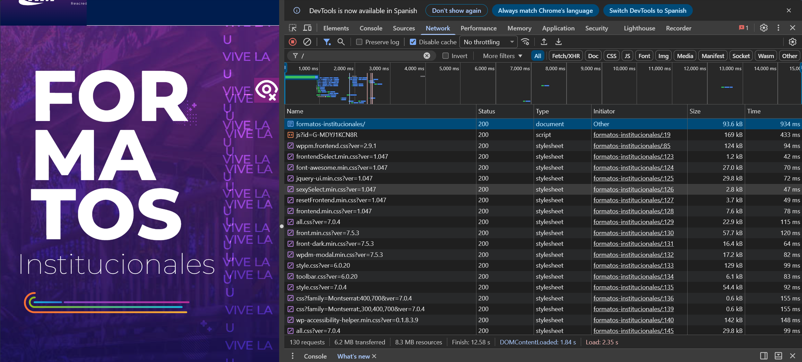
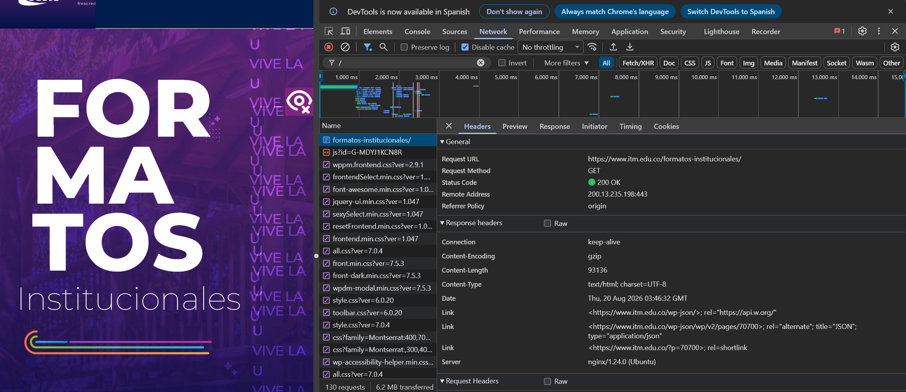
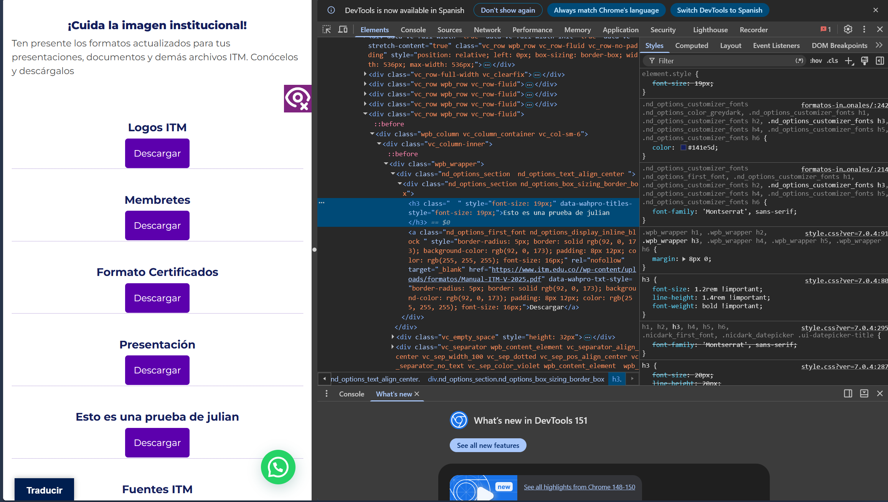
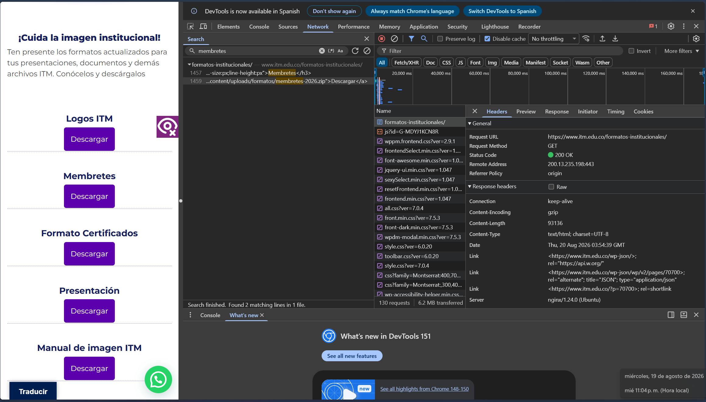

# Laboratorio 01: Análisis del funcionamiento de una aplicación web

**Estudiante:** Julián  
**Materia:** Aplicaciones y Servicios Web  
**Página analizada:** [itm.edu.co/formatos-institucionales](https://www.itm.edu.co/formatos-institucionales/)  
**Entrega:** Rama `clase3`  

---

## 1. Preparación del entorno
Para la realización de este laboratorio, ingresé a la página institucional del ITM desde Google Chrome y abrí las herramientas de desarrollo con la tecla `F12`. En este panel utilicé principalmente la pestaña **Network** (para monitorear las peticiones HTTP y los recursos cargados) y la pestaña **Elements** (para inspeccionar y modificar la estructura del DOM en tiempo real).

Estructura de la carpeta del proyecto creada en el computador:

```text
Aplicaciones-y-servicios-web/
└── laboratorio-01/
    ├── README.md
    └── evidencias/
        ├── network.png
        ├── request.png
        ├── dom.png
        └── interaccion.png
        
```       
        

## 2. Identificación de recursos

Al cargar la página con la opción Disable cache activa, el navegador descargó un total de 130 peticiones (requests), transfiriendo un peso total de 6.2 MB en aproximadamente 12.58 segundos.



A continuación se detallan 5 recursos de diferente tipo extraídos de la captura:

A continuación se detallan 5 recursos de diferente tipo extraídos de la captura:

| Recurso / Archivo | Tipo | Dominio | Tamaño |
|---|---|---|---|
| `formatos-institucionales/` | Document (HTML) | `www.itm.edu.co` | 93.6 KB |
| `js?id=G-MDYJ1KCN8R` | Script (JS) | `googletagmanager.com` | 169 KB |
| `wppm.frontend.css?ver=2.9.1` | Stylesheet (CSS) | `www.itm.edu.co` | 124 KB |
| `font-awesome.min.css?ver=1.0.47` | Stylesheet (CSS) | `www.itm.edu.co` | 27.0 KB |
| `css?family=Montserrat:400,700` | Font / CSS | `fonts.googleapis.com` | 0.6 KB |

> **¿Por qué una sola URL realiza tantas peticiones?**
Una página web moderna no es un solo archivo estático. El servidor envía primero la plantilla HTML básica y luego el navegador lee ese código y empieza a pedir por separado los estilos visuales (CSS), la lógica e interacción (JavaScript), tipografías externas y librerías adicionales.

## 3. Análisis de una solicitud
Se seleccionó la primera petición HTTP realizada al ingresar al sitio web (formatos-institucionales/).



| Parámetro | Valor |
|---|---|
| **URL de la solicitud** | `https://www.itm.edu.co/formatos-institucionales/` |
| **Método HTTP** | `GET` |
| **Código de Estado** | `200 OK` |
| **Dirección remota (IP)** | `200.13.235.198:443` |
| **Tipo de contenido** | `text/html; charset=UTF-8` |
| **Servidor web** | `nginx/1.24.0 (Ubuntu)` |

> **¿Qué recurso se solicitó y cómo sabemos que la respuesta fue exitosa?**
Se solicitó el documento principal HTML de la sección de formatos. Sabemos que fue exitosa porque el servidor devolvió el código de estado 200 OK, lo que indica que procesó la solicitud sin errores y entregó el contenido.

## 4. Inspección del DOM
Usando la pestaña Elements, seleccioné el elemento correspondiente a la etiqueta de título <h3> de la sección "Fuentes ITM", cuyo texto original era "Fuentes ITM".

Al editar el código desde las DevTools de Chrome, se cambió el texto del título por "Esto es una prueba de julian". La interfaz cambió inmediatamente en la pantalla.



¿El cambio realizado quedó guardado en el servidor?

No. La modificación solo ocurrió en la memoria RAM de la máquina local (en el árbol DOM que renderiza el navegador cliente). Al recargar la página, el navegador pide nuevamente el documento al servidor y el texto vuelve a su estado original.

## 5. Interacción dinámica
Al buscar y simular la interacción con el botón de descarga del recurso de Mambrotes, se analiza el comportamiento de las peticiones en la pestaña Network.

Acción realizada: Clic en el botón "Descargar" del apartado de Membretes.

Petición generada: El cliente abre la solicitud para obtener el archivo comprimido .zip ubicado en la ruta .../content/uploads/formatos/membretes-2026.zip.

Método y Estado: Petición con método GET que devuelve código 200 OK.

Relación entre la acción del usuario y la petición:



Al dar clic sobre el botón de la interfaz, el navegador procesa la etiqueta de enlace o evento JavaScript y genera una petición HTTP directa al servidor solicitando la descarga del archivo estático sin necesidad de refrescar la estructura completa de la página.

## 6. Diagrama del flujo
A continuación se ilustra el flujo de comunicación cliente-servidor observado durante la prueba:

[ Usuario / Navegador ]
```text
        │
        ├─── (1) GET [https://www.itm.edu.co/formatos-institucionales/](https://www.itm.edu.co/formatos-institucionales/) ────> [ Servidor Web Nginx ]
        │<── (2) HTTP 200 OK (Devuelve el HTML base) ─────────────────────┤
        │
        ├─── (3) Peticiones paralelas (CSS, JS, Fonts) ─────────────────> [ Servidores / CDNs ]
        │<── (4) HTTP 200 OK (Carga estilos y scripts) ───────────────────┤
        │
        ├─── (5) Clic en "Descargar" Membretes ───────────────────────────> [ Servidor de Archivos ]
        └─── (6) Descarga del archivo .zip ───────────────────────────────┘
```

## 7. Observado vs. Inferido
Lo que se observó directamente (Evidencia concreta)
Se observó la dirección IP del servidor (200.13.235.198).

Se registraron 130 peticiones HTTP individuales en la pestaña Network.

Se verificó el cambio en la vista del cliente al editar el texto del nodo <h3> en el panel de Elements.

Lo que se infirió (Deducción analítica)
Se infiere que el servidor utiliza el servidor web Nginx sobre una distribución de Linux (Ubuntu).

Se deduce que la página web utiliza la plataforma WordPress por la estructura de directorios observada (/wp-content/uploads/).

## 8. Conclusiones
La carga de páginas web es modular: Una sola vista en el navegador requiere decenas de solicitudes independientes (130 peticiones en este caso), lo que demuestra que la optimización de recursos estáticos es clave para la velocidad de la aplicación.

El cliente no altera el servidor: La manipulación del DOM mediante las herramientas de desarrollo confirma que la interfaz renderizada es totalmente independiente del almacenamiento persistente en el servidor.

Manejo de peticiones asíncronas: Las interacciones locales como la descarga de recursos permiten solicitar datos específicos al servidor en segundo plano sin interrumpir la experiencia global del usuario.

## 9. Entrega y lista de verificación
[x] El informe se ve bien en GitHub

[x] Las cuatro imágenes se muestran dentro del informe

[x] Están documentados al menos cinco recursos

[x] Se analizó una petición

[x] Se modificó un elemento de la página

[x] Se analizó una interacción

[x] El diagrama es propio y corresponde a lo observado

[x] Se separó lo observado de lo inferido

[x] Hay tres conclusiones

[x] Se subió todo al repositorio